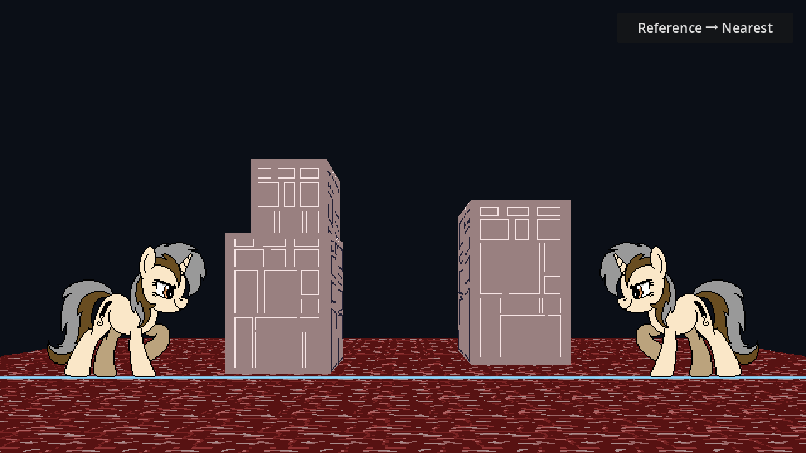

# 参考视角侧面：方案B制作与使用说明

> 日期：2026-11-14。已接入运行原型，尚未认定为最终像素风或完整抗闪烁方案。



## 1. 使用的素材

- `sprites/wall1.png`：128×256，矩形正面图。
- `sprites/wall2.png`：128×256，预绘斜侧面，图像右部和顶部有透明留白。
- 未修改或重画这两张源图；Reference场景使用原始单层贴图。

wall2的有效像素约x=0～112，顶边由近端y≈4升至远端y≈40，底边到y=255。边缘是像素阶梯，不能把整张128×256矩形当成实际墙面。

## 2. 本轮初始标定

每栋Reference建筑节点导出 `Side Reference Corners`，顺序固定为：

| 索引 | 意义 | 当前素材像素边界坐标 |
| --- | --- | --- |
| 0 | 近端顶 | (0,4) |
| 1 | 远端顶 | (113,41) |
| 2 | 远端底 | (113,256) |
| 3 | 近端底 | (0,256) |

这些坐标按Alpha轮廓作**近似标定**，不是从作者提供的精确相机信息恢复。采用像素边界而非像素中心，因此113表示最右可见列112之后的边界，256表示底部边界。

素材大小、透明边距或斜切角度变化后，在Inspector修改这四点；必须保持凸四边形、顺序一致，不自交或退化。当前代码面向实验，不包含任意无效四边形修复器。

## 3. 它不是“把斜图再贴上梯形”

```text
当前屏幕像素
→ 当前相机观察射线
→ 与侧墙求交，得到局部face_uv
→ side_reference_map，把局部坐标转到wall2参考四边形
→ 在wall2中取色，保留Alpha
```

设局部面到当前屏幕的映射为H_now，局部面到参考素材的映射为H_ref：

```text
参考素材位置 = H_ref × H_now^-1 × 当前屏幕位置
```

当前Shader用射线求交实现H_now^-1，不需要CPU显式求这个矩阵；`reference_building.gd` 计算H_ref，作为mat3传入Shader。这样实际墙面内容使用参考四边形，而不是把整张透明画布强行缩进当前侧面。

正面wall1是无透视矩形，直接用正面face_uv读取，未额外预投影。

## 4. “参考视角”到底由什么定义

当前程序保存的是**参考四边形**，没有独立ReferenceCamera节点，也不知道你原画使用的真实焦距、机位或是否有手工修形。

对平面贴图来说，这四点足以建立单应关系；但不能据此声称当前默认相机就是作者原机位，也不能保证所有建筑都在默认视角逐像素还原原图。

原图的“近端高度/远端高度”及世界建筑的高宽深可能并不严格匹配同一个物理相机。程序会按四点拟合；若想在某个机位尽量保留原画，应共同调整：

1. 建筑World Size与参考画面里应占的尺寸。
2. 建筑位置、当前相机X/Height及参考角点。
3. 素材自身的近远边比例与接合边。

不能只改四角就补出没有画过的背面、屋顶或层间遮挡。

## 5. 如何在Aseprite继续制作

- 正面、侧面放在独立图层，分开导出；侧面可以直接按参考角度手绘像素台阶。
- 保留透明留白，记录四个面角点与正侧面接合棱。
- 明确哪条边是近端，哪条是远端；本例wall2左边近、右边远。
- 正侧面接合边的细节、色彩和源像素密度应匹配设计，不要求两图同样分辨率。
- 对指定参考画面，远处建筑可以用较小或同分辨率素材表示更大世界体量，不强制所有物体的world_units_per_texel相同。
- 先用大色块和必要轮廓表达远景，不把“细节少”与“必须模糊”混为一谈。
- 静态手绘阴影已经在素材里时，不再默认额外乘0.6。需要时修改材质Side Brightness，而不是强制再压暗。

当前三栋楼复用同一组正侧图并适配各自World Size，只是演示，不代表这三栋建筑已遵守统一的正式美术比例。

### 5.1 整张地图母稿与中央建筑

正式美术按 [Aseprite分层绘制与交付规范](../方案/格斗地图Aseprite分层绘制与交付规范.md) 执行：先画参考机位总图、放两名角色作标尺，再拆分建筑面、景深层与动画装饰，并补齐可能揭露的区域。

中央建筑可以在同一Aseprite工程中隐藏front，在独立side层补画有面积的侧图，完成后恢复front合成。即使默认机位不显示side，仍应单独导出它并记录非退化参考四角；辅助相机截图只是可选标定办法，不是每次必需。源图四角不能为零宽，否则矩阵无法表示该面。

运行时不为露侧面而直接关掉正面：当前固定朝向下，左右平移通常看到正面加一侧。独立左右侧图、屋顶、任意旋转仍需扩展；当前共用一张侧图只是原型。

## 6. 左右观察

侧面局部横向定义为近端0→远端1。相机从右侧看时，近端通常出现在屏幕左侧；从左侧看时，空间投影会自然把相同素材镜像到另一方向。

Shader不会再做一次 `1-u` 翻转，否则会把近远参考角点调换。若建筑左右侧并不对称，未来应增加独立左侧图与对应参考角点，当前不假装一张图包含完整左右信息。

## 7. 像素、Alpha与采样的边界

- 素材像素经过相对投影后可以倾斜、变窄，不要求始终是屏幕轴对齐正方形。
- 当前使用Nearest，不把手绘边缘自动混色；这不等于相机移动时绝不闪烁。
- 与“先把预绘图还原到局部面再投影”的数学结果一致；方案B的价值在于正确解释预绘图的四边形与留白，不是绕过所有重采样。
- Alpha直接保留；仅透明区域不画，不生成对应厚度或内表面。轮廓缺失时先检查四点标定与原图，而非立即填成实色。
- 侧面很窄或远处细节低于输出分辨率时仍会丢失，不承诺始终可数8级。
- 较大镜头变化仍会拉伸原有手绘像素；正式方案应测试并限制适用视角，必要时准备不同参考方向素材，而不是无限变形一张图。

## 8. 代码与节点

- 新建 `scripts/reference_building.gd`：继承建筑几何更新，并把单位矩形→参考四边形的单应矩阵写入材质。
- 新建 `shaders/building_reference.gdshader`：两张素材、当前射线求交、参考映射与Alpha输出。
- 新建 `scenes/battle_map_reference.tscn`：保留地图、玩家、相机与地面；三栋建筑使用新脚本 / 材质。
- F5默认进入Reference，右上角只在Reference与Nearest之间切换。

本轮内部画布已提高到1280×720，焦距/Horizon加倍保持同构图，世界布局、源图、WASD、R复位不变。玩家脚点变为(1080,600)/(200,600)，显示scale约2；不再据角色像素计算屏幕规格。未添加include、全局Shader参数、SubViewport或精灵堆叠。

## 9. 验证与尚需人工判断

Godot4.7、D3D12 Mobile通过：

- 四个参考角点映射正确，三栋建筑共363个内部点正反映射验证通过。
- 独立侧面3901个实际输出像素与CPU计算的参考素材Nearest采样颜色一致，最大通道差为0。
- 左右相机位置与不同Height可渲染；当前高分辨率下角色保持约2倍输出尺度，构图不变。
- Reference↔Nearest双向切换保留相机状态。

这验证了实现和矩阵方向，不代表用户的目标美术风格、运动稳定性或大角度外观已经通过。后续应在同一路径录像观察。

Shader变量与材质传参参考Godot官方：`https://docs.godotengine.org/en/stable/tutorials/shaders/shader_reference/shading_language.html`。本项目矩阵与四角约定由代码定义，不是编辑器自动猜测。