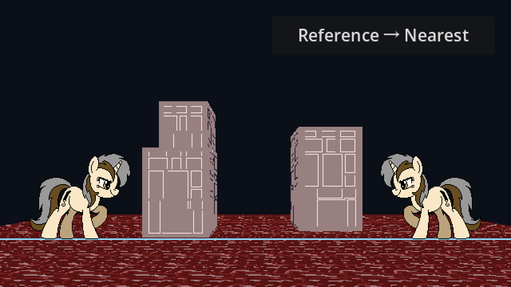
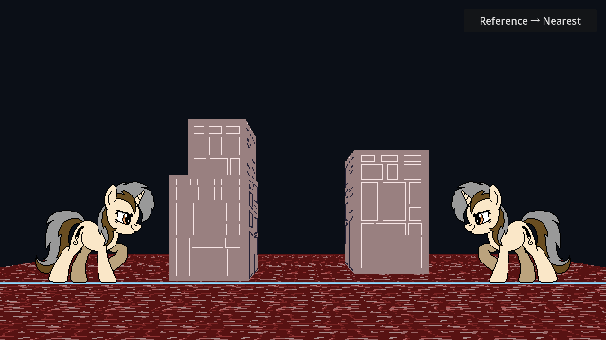

# 提高内部渲染分辨率：操作与效果边界

> 2026-11-14。当前先测试1280×720原生画布，不再用角色像素宽高计算屏幕规格。

## 1. 闪动是否因为一源像素只对应一个屏幕像素？

它是容易出现问题的情况之一，但不是唯一原因，也不是准确的充分条件。

源纹素投影接近或小于一个输出像素时，Nearest采样点跨过纹素边界就可能换色；侧面斜视时，一个输出像素还可能覆盖多个纹素。即使一个源纹素占多个输出像素，斜边、Alpha硬轮廓或亚像素移动也会产生边界跳步。

提高内部画布可以增加采样点、让原画轮廓更容易表达；不会让连续运动与离散取样从此无冲突。源图本身的细线、近乎消失的侧面和大角度变形仍需单独判断。

## 2. 本轮具体改动

| 项目 | 原来 | 当前 |
| --- | --- | --- |
| 内部渲染画布 | 640×360 | 1280×720 |
| 窗口 | 1280×720 | 1280×720，不变 |
| 最后显示 | 低清结果放大2倍 | 原生1倍 |
| 焦距 | 约466.6667 | 约933.3333 |
| Horizon | 230 | 460 |
| 相机世界X/Z、Height | (0,-1400)、210 | 不变 |
| 世界体积与玩家站位 | 原值 | 不变 |
| 角色每源像素输出尺度 | 约1输出像素 | 约2输出像素 |
| 玩家脚点 | (540,300)/(100,300) | (1080,600)/(200,600) |
| 右上角按钮 | 多方案轮换 | 仅Reference ↔ Nearest |

宽高各增2倍，输出像素总数是原来的4倍，实际耗时需实测，不推断为帧率一定降4倍。

**只扩大窗口仍旧放大低清图，不会增加Shader取样。本轮改变的是实际渲染目标。** 焦距和Horizon同步增大，避免“分辨率提高但物体占比减半”干扰对照。

当前仍固定内部1280×720，不是动态跟随所有窗口尺寸；以后若继续改分辨率，应保持CPU投影、Shader的screen_size、焦距和Horizon一致。素材世界体量不因输出改变而重新计算。

## 3. 静态对照

同一机位与动画暂停帧：

旧640×360画布放大到1280×720：

新1280×720原生画布：

两张物理尺寸相同，构图相同。观察侧墙细线、透明轮廓、接合边和远处地面；人物在参考机位恰好等比整倍放大，两张人物可能非常相近，这不代表整个世界采样相同。

## 4. 如何看动态效果

1. F5运行Reference场景，保持默认窗口，不用系统放大后再比较截图。
2. 只按A/D慢移，观察侧面内部；再只按W/S看边缘变化。
3. 查看是否从大块跳动变成更细的边缘跳动，记录哪类细节仍丢失。
4. 更换观察位置时保持相同世界速度和轨迹，不用改变焦距制造不公平对比。
5. 原Nearest场景只是旧材质/映射参考，不能把Reference换图与分辨率收益混成同一件事。

当前没有新增自动抗闪烁算法、相机量化或额外后处理。不能仅凭静帧清楚就写“闪动已修复”。

## 5. 删除与保留边界

相关多级缩小采样实验场景、专用Shader、说明与旧采样图示已移除；floor.png导入恢复原始单层。所有当前Shader继续使用明确的Nearest。

保留Reference方案B、旧普通Nearest场景、原始源图、地面辅助线、角色动画、导出预设和release目录。引擎导入文件里保留其标准关闭字段是正常配置，不代表相关算法仍启用。

旧导出包未重建；要测试本轮结果请F5运行源码或重新导出，不能使用此前的release包判断当前行为。

## 6. 技术验证

Godot4.7、D3D12 Mobile实际运行通过：1280×720渲染纹理、世界参数与构图等比一致、角色scale2、脚点600、纹理没有额外缩小层、与旧低清放大图确有差异、两个按钮方向及相机状态正常。

上述只验证实现与静态取样差异，不量化人眼看到的时间稳定性。后续可录制同一路径，分别验收侧面内容和轮廓。